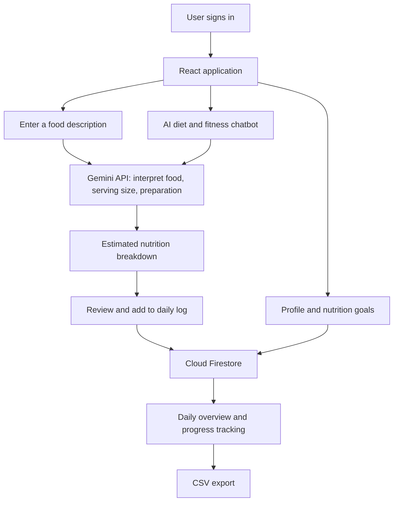

# NutriCount — AI-Powered Nutrition Tracker

**A responsive nutrition-tracking web application that uses Google Gemini to interpret everyday food descriptions, estimate nutritional values, and support personalized daily goals.**

NutriCount (called **NutriCounter** in the project's original academic documentation) was developed to make food logging easier for people who don't measure every ingredient in grams. Rather than requiring rigid food-database inputs, the application accepts descriptions such as *"2 scrambled eggs with a slice of toast"* and uses AI to identify foods, portions, and preparation methods.

> **Academic project:** Developed as part of ITS 120L at Mapúa University (2025). This is a working project/prototype, not a clinically validated nutrition or medical service. AI-generated figures are estimates.

## Features

### AI-assisted nutrition calculator
- Enter food descriptions in natural language, including approximate serving sizes and preparation methods.
- Use the **Google Gemini API** to interpret food items and estimate their nutritional information.
- Display a meal's estimated calories and nutritional breakdown, including macronutrients.
- Add estimated foods to a daily log, then edit or remove logged entries.

### Personalized nutrition goals
- Enter profile information such as age, height, weight, activity level, and health goal.
- Calculate BMI and use AI-assisted suggestions to generate daily nutrition targets.
- Alternatively, set calorie, protein, carbohydrate, and fat targets manually.
- Track consumed nutrients against daily goals from the overview dashboard.

### Nutrition-oriented AI chatbot
- Ask questions related to diet and workout planning.
- Receive AI-generated guidance based on the profile and goals supplied to the application.
- The chatbot uses topic-focused prompts intended to keep responses within nutrition and fitness topics.

### User accounts and reporting
- Register and sign in with **Firebase Authentication**.
- Save user profiles, nutrition goals, and food logs in **Cloud Firestore**.
- View recent foods and daily totals in a responsive dashboard.
- Export a daily overview to **CSV**, including user profile details, daily totals, and logged foods.

## Tech stack

| Area | Technology |
| --- | --- |
| Language | JavaScript (ES6+), JSX |
| Frontend | React |
| Styling | Tailwind CSS |
| Authentication | Firebase Authentication |
| Database | Cloud Firestore (NoSQL) |
| AI integration | Google Gemini API |
| Supporting libraries | `lucide-react`, `react-csv` |
| Development | Node.js, npm, Git |

## How it works



**Data flow:** The React interface collects a user's input, Gemini helps interpret the food description, and the application presents estimated nutrients. Logged meals and goal information are associated with the signed-in user through Firebase services.

## Main application modules

The original project documentation identifies the following modules:

| Component | Responsibility |
| --- | --- |
| `AuthContext.jsx`, `AuthPage.jsx`, `AuthForm.jsx` | Authentication state, registration, and login interface |
| `NutriCounter.jsx` | Dashboard, calculator, settings, nutrition goals, and food logging |
| `Chatbot.jsx` | Nutrition- and fitness-focused AI assistant |
| `FoodEditModal` | Editing nutritional values of logged foods |
| `firebase.js` | Firebase Authentication and Firestore initialization |

*These are component names from the project documentation; their exact directory locations may differ in the current repository.*

## Getting started

### Prerequisites
- Node.js and npm (the original documentation specifies Node.js 16+ and npm 8+).
- A Firebase project with Email/Password Authentication and Cloud Firestore configured.
- Access to the Google Gemini API.

### Local setup

1. Clone the repository:

   ```bash
   git clone https://github.com/Michael-Kambayashi/NutriCount.git
   cd NutriCount
   ```

2. Install dependencies in the directory containing the application's `package.json`:

   ```bash
   npm install
   ```

3. Configure the Firebase settings expected by the project's `firebase.js` module and enable the appropriate Firestore security rules.
4. Configure Gemini API access using the mechanism provided by your copy of the application. The documented app includes an option for users to supply their own API key.
5. Check which scripts the repository supports:

   ```bash
   npm run
   ```

   Then run the applicable development script (for example, `npm run dev` or `npm start`) and open the local URL displayed in the terminal.

> **Setup note:** The current repository's `package.json`, Firebase configuration format, and exact startup script have not been independently verified for this README. Follow the scripts and configuration names actually present in the repository.

### Security considerations

- **Never commit real Gemini API keys, Firebase service-account credentials, or other secrets.**
- Firebase web configuration is not a substitute for security. Enforce user-level access using Firebase Authentication and appropriate Firestore Security Rules.
- Exposing a Gemini key in browser-side code can make it accessible to users. For a publicly deployed version, consider moving key-bearing Gemini requests behind a secured backend or serverless function.

## Example usage

1. Create an account or sign in.
2. In **Settings**, enter profile details and choose AI-generated or manual nutrition goals.
3. Open the **Calculator** and enter a meal, such as `2 scrambled eggs, 1 slice of toast, and half an avocado`.
4. Review the AI-estimated nutrition breakdown and add the meal to the daily log.
5. Check the **Overview** for daily totals, edit food entries if needed, or export a CSV report.
6. Use the in-app chatbot for general diet- or fitness-related planning questions.

## Project Documentation

For a detailed explanation of the system architecture,
use case diagrams, application modules, database design,
screenshots, and testing procedures, see the full
academic documentation:

[View NutriCount Project Documentation (PDF)](docs/NutriCountDocumentation.pdf)

## Limitations

- Nutrient estimates depend on input clarity, assumed portion sizes, preparation methods, and information available to the AI service.
- Descriptions such as *"a handful"* or *"a splash"* are inherently approximate; the application cannot guarantee laboratory-level nutrient accuracy.
- AI-generated nutrition and workout guidance is general informational content, not a substitute for guidance from a qualified healthcare or nutrition professional.
- The application is documented as a responsive **web app**; it is not presented here as a separately packaged native mobile application.

## Project background

NutriCount was developed as an academic application to explore how natural-language AI interfaces can make nutritional tracking more accessible. The project combines a React user interface with Firebase-backed persistence and Gemini-based analysis to turn everyday meal descriptions into editable logs and daily-goal summaries.

**Author / project documentation:** Michael Mario P. Kambayashi  
**Source code:** [github.com/Michael-Kambayashi/NutriCount](https://github.com/Michael-Kambayashi/NutriCount)

---
